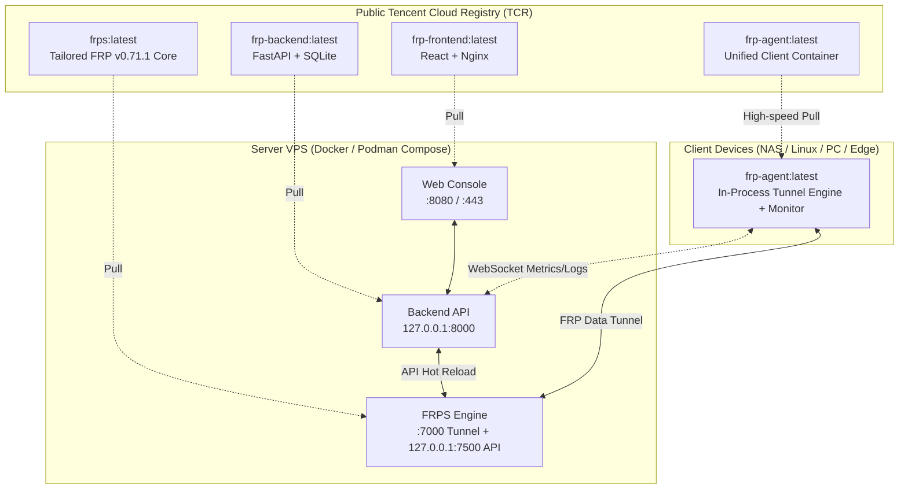

<div align="center">
  <h1>FRP-ALL-IN-ONE</h1>
  <p>A web-based, fully containerized FRP reverse proxy management platform: configure <b>FRPS server</b>, <b>onboard client devices via containers</b>, manage <b>port mappings</b>, and view <b>real-time streaming traffic & system resource monitoring</b> directly in your browser.</p>
  <p><b>100% Containerized Architecture · High-Speed Tencent Cloud Registry CDN · Embedded Tailored FRP v0.71.1 Core</b></p>
  <p>
    <a href="https://github.com/GreenhandTan/FRP-ALL-IN-ONE/stargazers"></a>
    <a href="LICENSE"></a>
    
    
    
    
    
  </p>
  <p>
    <a href="#highlights">Highlights</a> ·
    <a href="#demo">Demo</a> ·
    <a href="#architecture">Architecture</a> ·
    <a href="#quick-start-server">Server Deployment</a> ·
    <a href="#ports">Ports</a> ·
    <a href="#maintainer">Maintainers</a> ·
    <a href="#license">License</a>
  </p>
  <p>
    <a href="README.md">简体中文</a> |
    <a href="README.en.md">English</a> |
    <a href="README.zh-TW.md">繁體中文</a>
  </p>
</div>

<a id="demo"></a>

## Demo

<p align="center">
  
</p>

<details>
  <summary><b>Click to expand full feature gallery screenshots</b></summary>
  <br />
  <table>
    <tr>
      <td align="center" width="50%"><br /><sub><b>Device & Tunnel Status Management</b></sub></td>
      <td align="center" width="50%"><br /><sub><b>Container Onboarding Wizard</b></sub></td>
    </tr>
    <tr>
      <td align="center" width="50%"><br /><sub><b>HTTPS & System Settings</b></sub></td>
      <td align="center" width="50%"><br /><sub><b>Mobile Adaptation & Logs</b></sub></td>
    </tr>
  </table>
</details>

---

<a id="highlights"></a>

## Highlights

- **100% Container-Driven (Zero Source Compilation)**: Both server and client deploy via ready-to-run container images. No need to install Node.js, Go, or Python build tools on host machines.
- **Tencent Cloud Registry (TCR) Fast Distribution**: Distributed via public Tencent Cloud registry with high-speed CDN, eliminating DockerHub throttling and GitHub connection timeouts.
- **Hardware-Independent Single Client Image**: Clients run a unified `frp-agent:latest` container regardless of CPU architectures (x86/ARM compatible), embedding a tailored FRP v0.71.1 in-process engine.
- **Production-Grade Security**:
  - Initial login superadmin whitelist protection (prevents public hijack)
  - Pre-generated cryptographically secure tokens on port 7000
  - Reverse-proxy aware rate limiting and localhost isolation
  - Automatic Let's Encrypt TLS certificate issue and renewal
- **Real-Time Streaming Monitoring**: WebSocket stream for client CPU, memory, real-time traffic in/out rates, and aggregated bandwidth statistics.

---

<a id="architecture"></a>

## Architecture



---

<a id="quick-start-server"></a>

## Server Deployment Guide

> **Note**: No `git clone` or source code download required! The server is deployed completely via container images.

### 1. Create GitHub OAuth App

This platform uses GitHub OAuth for authentication. Create your OAuth App first:

1. Open [GitHub Developer Settings](https://github.com/settings/developers)
2. Click **New OAuth App**:
   - **Application name**: `FRP Manager`
   - **Homepage URL**: `http://<YOUR_SERVER_IP>:8080` (or domain)
   - **Authorization callback URL**: `http://<YOUR_SERVER_IP>:8080/api/auth/github/callback`
3. Save your **Client ID** and generate a **Client Secret**.

---

### 2. One-Line Deployment (Recommended)

Run the automated deployment script on your Linux server:

```bash
curl -fsSL https://raw.githubusercontent.com/GreenhandTan/FRP-ALL-IN-ONE/main/deploy/deploy.sh | sudo bash
```

The script will prompt for your `GITHUB_CLIENT_ID`, `GITHUB_CLIENT_SECRET`, and optional `INITIAL_ADMIN_GITHUB_USERNAME` for anti-hijack protection.

---

### 3. Or via Standard Docker Compose

If you prefer manual compose management:

```bash
mkdir -p frp-manager && cd frp-manager

# Download standard compose file
curl -fsSL https://raw.githubusercontent.com/GreenhandTan/FRP-ALL-IN-ONE/main/deploy/compose.yml -o compose.yml

# Create environment configuration
cat > .env <<EOF
GITHUB_CLIENT_ID=your_client_id
GITHUB_CLIENT_SECRET=your_client_secret
SECRET_KEY=$(head -c 32 /dev/urandom | base64 | tr -d '\n/+=')
INITIAL_ADMIN_GITHUB_USERNAME=your_github_username
EOF

# Pull and start services
docker compose up -d
```

Open `http://<YOUR_SERVER_IP>:8080` in your browser.

> **Client Device Onboarding**: Once the server is running, log into the Web Console, go to **Devices** → click **Add Device**, and copy the auto-generated one-click container command or setup script to your edge device.

---

<a id="ports"></a>

## Firewall & Port Rules

Ensure the following ports are allowed in your server's security group:

| Port | Protocol | Usage |
| :--- | :--- | :--- |
| **8080** | TCP | Web Management Console (Default) |
| **80** | TCP | HTTP redirect and Let's Encrypt validation (Required for HTTPS) |
| **443** | TCP | Web Console HTTPS access (Optional) |
| **7000** | TCP | FRP Tunnel Control port |
| **Custom range** | TCP/UDP | Your exposed remote service ports (e.g. 6001, 8081) |

---

<a id="maintainer"></a>

## Maintainer Release Guide

For open-source maintainers, build and publish all 4 container images to the public registry with a single command:

```bash
# Build and push frps, frp-backend, frp-frontend, and frp-agent to TCR
sh deploy/build-and-push.sh [VERSION_TAG, default: latest]
```

---

<a id="troubleshooting"></a>

## Troubleshooting

1. **`initial_admin_mismatch` during login?**
   - You specified `INITIAL_ADMIN_GITHUB_USERNAME`, and the current GitHub account does not match the configured admin.
2. **Tunnel created but remote port unreachable?**
   - Check cloud security group rules to ensure the remote port allows incoming TCP/UDP traffic.
3. **HTTPS Certificate generation failed?**
   - Ensure your domain A record points to the server IP and port **80** is open to the public for HTTP-01 validation.

---

<a id="license"></a>

## License

This project is licensed under [Apache-2.0](LICENSE). The tailored FRP core respects the [original FRP License](https://github.com/fatedier/frp/blob/dev/LICENSE).
