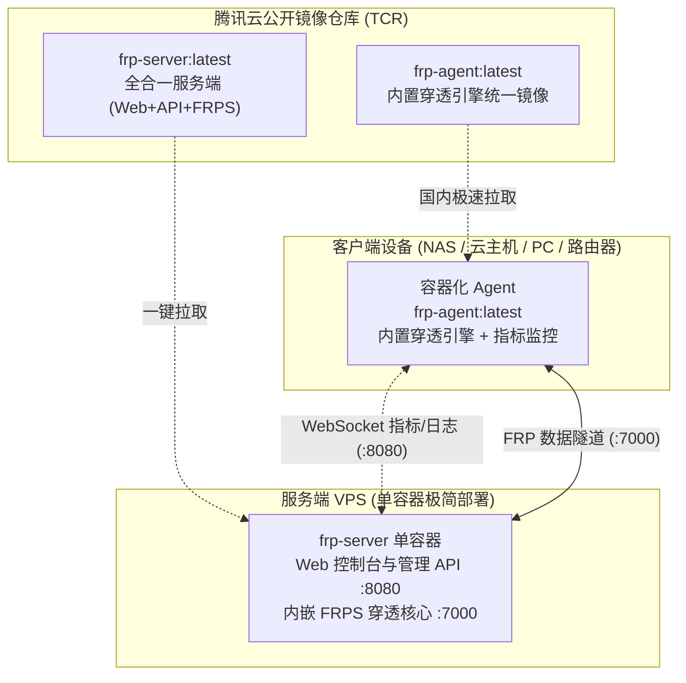

<div align="center">
  <h1>FRP-ALL-IN-ONE</h1>
  <p>基于 Web 的全容器化 FRP 内网穿透集中管理系统：用现代化浏览器完成 <b>FRPS 服务端配置</b>、<b>设备一键容器化入网</b>、<b>端口映射管理</b>，并提供<b>秒级实时流量与系统资源监控</b>。</p>
  <p><b>全容器化架构 · 腾讯云公开镜像极速拉取 · 内置定制 FRP v0.71.1 内核</b></p>
  <p>
    <a href="https://github.com/newbietan/FRP-ALL-IN-ONE/stargazers"></a>
    <a href="LICENSE"></a>
    
    
    
    
    
  </p>
  <p>
    <a href="#highlights">核心优势</a> ·
    <a href="#demo">效果演示</a> ·
    <a href="#architecture">架构说明</a> ·
    <a href="#quick-start-server">服务端部署</a> ·
    <a href="#ports">端口放行</a> ·
    <a href="#license">开源协议</a>
  </p>
  <p>
    <a href="README.md">简体中文</a> |
    <a href="README.en.md">English</a> |
    <a href="README.zh-TW.md">繁體中文</a>
  </p>
</div>

<a id="demo"></a>

## 效果演示

<p align="center">
  
</p>

<details>
  <summary><b>点击展开查看更多功能界面截图</b></summary>
  <br />
  <table>
    <tr>
      <td align="center" width="50%"><br /><sub><b>设备与隧道状态管理</b></sub></td>
      <td align="center" width="50%"><br /><sub><b>添加设备与容器向导</b></sub></td>
    </tr>
    <tr>
      <td align="center" width="50%"><br /><sub><b>HTTPS 与网络配置</b></sub></td>
      <td align="center" width="50%"><br /><sub><b>移动端与日志监控</b></sub></td>
    </tr>
  </table>
</details>

---

<a id="highlights"></a>

## 核心优势

- **全流程容器化（免拉取源码编译）**：服务端与客户端全面采用容器镜像部署，无需在宿主机安装任何 Node.js、Go、Python 编译环境，告别繁重的本地构建。
- **腾讯云公开镜像极速分发**：所有组件统一收拢至腾讯云公开容器镜像仓库（TCR），国内网络享受千兆 CDN 极速秒拉，彻底告别 DockerHub 限流与 GitHub 网络超时。
- **客户端单镜像自闭环**：客户端统一拉取 `frp-agent:latest` 容器，不区分芯片型号与硬件架构（x86/ARM 通用自适应），内置定制裁剪版 FRP v0.71.1 穿透引擎，免去外部解压配置。
- **生产级安全防护**：
  - 首登超级管理员白名单防护（防止公网抢占）
  - FRPS 默认强随机密钥（防止 7000 端口未授权穿透）
  - 后端严格绑定本地回环，具备安全反代感知限流（防止全局误封）
  - 自动申请 Let's Encrypt TLS 证书并后台无缝续期
- **毫秒级事件驱动监控**：WebSocket 实时流式推送客户端 CPU、内存、实时网络出入速率及流量统计，配置变更内存级热重载生效。

---

<a id="architecture"></a>

## 架构说明



---

<a id="quick-start-server"></a>

## 服务端部署指南

> **提示**：无需使用 `git clone` 拷贝项目源码！服务端仅需通过标准容器编排拉取公开镜像即可启动。

### 1. 准备 GitHub OAuth App

本系统使用 GitHub OAuth 进行管理员认证，请先创建属于你的 OAuth App：

1. 打开 [GitHub Developer Settings](https://github.com/settings/developers)
2. 点击 **New OAuth App** 填写：
   - **Application name**：`FRP Manager`（或自定义名称）
   - **Homepage URL**：`http://<你的服务器IP>:8080`（或你的域名）
   - **Authorization callback URL**：`http://<你的服务器IP>:8080/api/auth/github/callback`
3. 创建后记录 **Client ID**，并生成 **Client Secret**。

---

### 2. 一键极速部署（推荐）

直接在服务器执行自动化部署脚本（自动识别系统、就绪 Docker/Podman 并从腾讯云镜像源秒级拉取启动）：

```bash
curl -fsSL https://raw.githubusercontent.com/newbietan/FRP-ALL-IN-ONE/main/deploy/deploy.sh | sudo bash
```

脚本将引导填写 `GITHUB_CLIENT_ID`、`GITHUB_CLIENT_SECRET` 以及**初始管理员 GitHub 用户名**（开启防抢占防护）。

---

### 3. 或者通过标准 Docker Compose 部署

若习惯手动管理 Compose 配置：

```bash
mkdir -p frp-manager && cd frp-manager

# 下载标准化 compose 编排文件
curl -fsSL https://raw.githubusercontent.com/newbietan/FRP-ALL-IN-ONE/main/deploy/compose.yml -o compose.yml

# 创建环境变量配置文件
cat > .env <<EOF
GITHUB_CLIENT_ID=你的ClientID
GITHUB_CLIENT_SECRET=你的ClientSecret
SECRET_KEY=$(head -c 32 /dev/urandom | base64 | tr -d '\n/+=')
INITIAL_ADMIN_GITHUB_USERNAME=你的GitHub用户名
EOF

# 一键拉取并启动服务
docker compose up -d
```

启动完成后，打开浏览器访问 `http://<服务器IP>:8080` 即可开始使用。

> **客户端接入说明**：登录 Web 控制台后，在「设备管理」页面点击「添加新设备」，系统会自动生成对应的容器一键启动命令（支持 Docker、Linux 自动安装脚本、Windows 与 macOS 引导），复制并在客户端机器执行即可完成接入。

---

<a id="ports"></a>

## 端口放行建议

请确保云服务器防火墙 / 安全组放行以下必要端口：

| 端口 | 协议 | 用途说明 |
| :--- | :--- | :--- |
| **8080** | TCP | Web 管理控制台（默认访问端口） |
| **80** | TCP | HTTP 自动跳转及 Let's Encrypt 证书申请验证（启用 HTTPS 时必选） |
| **443** | TCP | Web 控制台 HTTPS 访问（启用 HTTPS 后可选） |
| **7000** | TCP | FRP 穿透隧道主连接端口 |
| **自定义区间** | TCP/UDP | 你映射出的远程服务端口（如 6001、8081 等） |

---

<a id="troubleshooting"></a>

## 常见排障

1. **GitHub 登录后提示 `initial_admin_mismatch`？**
   - 说明你在 `.env` 中指定了 `INITIAL_ADMIN_GITHUB_USERNAME`，但当前登录的账号与预设不符，系统自动拦截了越权激活。
2. **端口映射成功但外网无法访问？**
   - 检查云服务器控制台的安全组规则，确认对应的远程端口是否已开放 TCP/UDP 流量。
3. **域名 HTTPS 证书申请失败？**
   - 确认域名 A 记录已完全解析到服务器公网 IP，且安全组的 **80 端口** 已对外开放（用于 Let's Encrypt 挑战验证）。

---

<a id="license"></a>

## 开源协议

本项目采用 [Apache-2.0](LICENSE) 协议开源。定制版内核遵循 [FRP 原版开源许可](https://github.com/fatedier/frp/blob/dev/LICENSE)。
