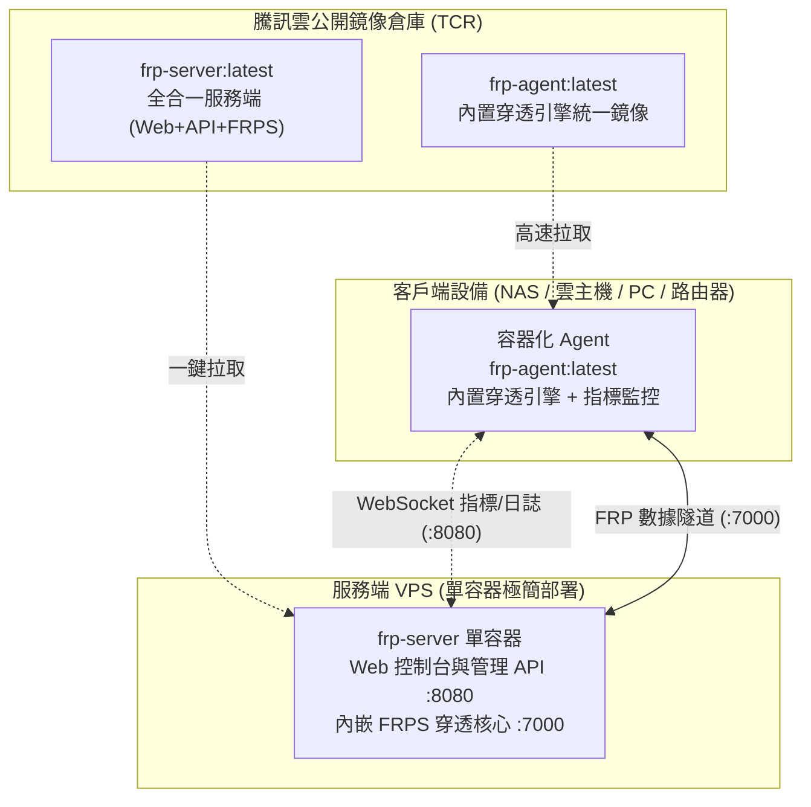

<div align="center">
  <h1>FRP-ALL-IN-ONE</h1>
  <p>基於 Web 的全容器化 FRP 内網穿透集中管理系統：用現代化瀏覽器完成 <b>FRPS 服務端配置</b>、<b>設備一鍵容器化入網</b>、<b>端口映射管理</b>，並提供<b>秒級實時流量與系統資源監控</b>。</p>
  <p><b>全容器化架構 · 騰訊雲公開鏡像極速拉取 · 內置定制 FRP v0.71.1 核心</b></p>
  <p>
    <a href="https://github.com/newbietan/FRP-ALL-IN-ONE/stargazers"></a>
    <a href="LICENSE"></a>
    
    
    
    
    
  </p>
  <p>
    <a href="#highlights">核心優勢</a> ·
    <a href="#demo">效果展示</a> ·
    <a href="#architecture">架構說明</a> ·
    <a href="#quick-start-server">服務端部署</a> ·
    <a href="#ports">端口放行</a> ·
    <a href="#license">開源協議</a>
  </p>
  <p>
    <a href="README.md">简体中文</a> |
    <a href="README.en.md">English</a> |
    <a href="README.zh-TW.md">繁體中文</a>
  </p>
</div>

<a id="demo"></a>

## 效果展示

<p align="center">
  
</p>

<details>
  <summary><b>點擊展開查看更多功能介面截圖</b></summary>
  <br />
  <table>
    <tr>
      <td align="center" width="50%"><br /><sub><b>設備與隧道狀態管理</b></sub></td>
      <td align="center" width="50%"><br /><sub><b>添加設備與容器向導</b></sub></td>
    </tr>
    <tr>
      <td align="center" width="50%"><br /><sub><b>HTTPS 與網路配置</b></sub></td>
      <td align="center" width="50%"><br /><sub><b>移動端與日誌監控</b></sub></td>
    </tr>
  </table>
</details>

---

<a id="highlights"></a>

## 核心優勢

- **全流程容器化（免拉取源碼編譯）**：服務端與客戶端全面採用容器鏡像部署，無需在宿主機安裝任何 Node.js、Go、Python 編譯環境，告別繁重的本地構建。
- **騰訊雲公開鏡像極速分發**：所有組件統一收攏至騰訊雲公開容器鏡像倉庫（TCR），國內外網路均可享受極速秒拉，徹底告別 DockerHub 限流與 GitHub 網路超時。
- **客戶端單鏡像自閉環**：客戶端統一拉取 `frp-agent:latest` 容器，不區分芯片型號與硬體架構（x86/ARM 通用自適應），內置定制裁剪版 FRP v0.71.1 穿透引擎，免去外部解壓配置。
- **生產級安全防護**：
  - 首登超級管理員白名單防護（防止公網搶佔）
  - FRPS 默認強隨機密鑰（防止 7000 端口未授權穿透）
  - 後端嚴格綁定本地回環，具備安全反代感知限流（防止全局誤封）
  - 自動申請 Let's Encrypt TLS 證書並後台無縫續期
- **毫秒級事件驅動監控**：WebSocket 實時流式推送客戶端 CPU、內存、實時網路出入速率及流量統計，配置變更內存級熱重載生效。

---

<a id="architecture"></a>

## 架構說明



---

<a id="quick-start-server"></a>

## 服務端部署指南

> **提示**：無需使用 `git clone` 拷貝項目源碼！服務端僅需通過標準容器編排拉取公開鏡像即可啟動。

### 1. 準備 GitHub OAuth App

本系統使用 GitHub OAuth 進行管理員認證，請先創建屬於你的 OAuth App：

1. 打開 [GitHub Developer Settings](https://github.com/settings/developers)
2. 點擊 **New OAuth App** 填寫：
   - **Application name**：`FRP Manager`（或自定義名稱）
   - **Homepage URL**：`http://<你的服務器IP>:8080`（或你的域名）
   - **Authorization callback URL**：`http://<你的服務器IP>:8080/api/auth/github/callback`
3. 創建後記錄 **Client ID**，並生成 **Client Secret**。

---

### 2. 一鍵極速部署（推薦）

直接在服務器執行自動化部署腳本（自動識別系統、就緒 Docker/Podman 並從騰訊雲鏡像源秒級拉取啟動）：

```bash
curl -fsSL https://raw.githubusercontent.com/newbietan/FRP-ALL-IN-ONE/main/deploy/deploy.sh | sudo bash
```

腳本將引導填寫 `GITHUB_CLIENT_ID`、`GITHUB_CLIENT_SECRET` 以及**初始管理員 GitHub 用戶名**（開啟防搶佔防護）。

---

### 3. 或者通過標準 Docker Compose 部署

若習慣手動管理 Compose 配置：

```bash
mkdir -p frp-manager && cd frp-manager

# 下載標準化 compose 編排文件
curl -fsSL https://raw.githubusercontent.com/newbietan/FRP-ALL-IN-ONE/main/deploy/compose.yml -o compose.yml

# 創建環境變量配置文件
cat > .env <<EOF
GITHUB_CLIENT_ID=你的ClientID
GITHUB_CLIENT_SECRET=你的ClientSecret
SECRET_KEY=$(head -c 32 /dev/urandom | base64 | tr -d '\n/+=')
INITIAL_ADMIN_GITHUB_USERNAME=你的GitHub用戶名
EOF

# 一鍵拉取並啟動服務
docker compose up -d
```

啟動完成後，打開瀏覽器訪問 `http://<服務器IP>:8080` 即可開始使用。

> **客戶端接入說明**：登錄 Web 控制台後，在「設備管理」頁面點擊「添加新設備」，系統會自動生成對應的容器一鍵啟動命令，複製並在客戶端機器執行即可完成接入。

---

<a id="ports"></a>

## 端口放行建議

請確保雲服務器防火牆 / 安全組放行以下必要端口：

| 端口 | 協議 | 用途說明 |
| :--- | :--- | :--- |
| **8080** | TCP | Web 管理控制台（默認訪問端口） |
| **80** | TCP | HTTP 自動跳轉及 Let's Encrypt 證書申請驗證（啟用 HTTPS 時必選） |
| **443** | TCP | Web 控制台 HTTPS 訪問（啟用 HTTPS 後可選） |
| **7000** | TCP | FRP 穿透隧道主連接端口 |
| **自定義區間** | TCP/UDP | 你映射出的遠程服務端口（如 6001、8081 等） |

---

<a id="troubleshooting"></a>

## 常見排障

1. **GitHub 登錄後提示 `initial_admin_mismatch`？**
   - 說明你在 `.env` 中指定了 `INITIAL_ADMIN_GITHUB_USERNAME`，但當前登錄的賬號與預設不符，系統自動攔截了越權激活。
2. **端口映射成功但外網無法訪問？**
   - 檢查雲服務器控制台的安全組規則，確認對應的遠程端口是否已開放 TCP/UDP 流量。
3. **域名 HTTPS 證書申請失敗？**
   - 確認域名 A 記錄已完全解析到服務器公网 IP，且安全組的 **80 端口** 已對外開放（用於 Let's Encrypt 挑戰驗證）。

---

<a id="license"></a>

## 開源協議

本項目採用 [Apache-2.0](LICENSE) 協議開源。定制版核心遵循 [FRP 原版開源許可](https://github.com/fatedier/frp/blob/dev/LICENSE)。
