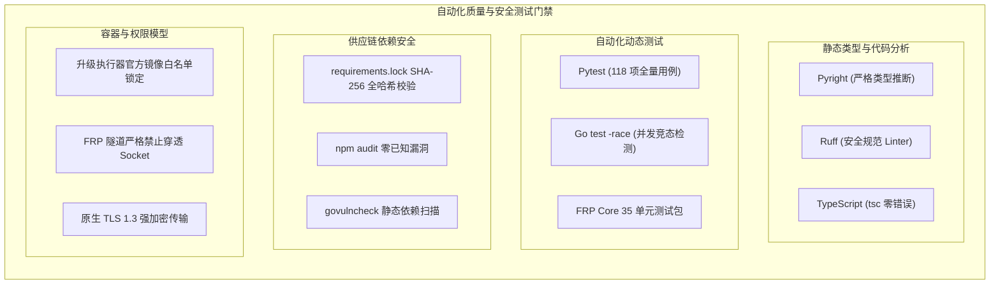

# 安全与质量保障策略 (Security and Quality Policy)

本文件规定了 **FRP-ALL-IN-ONE** 开源项目的安全支持周期、历史漏洞通告、泄露排查指引、工程质量保障基准以及负责任的漏洞披露流程。

---

## 一、 支持的版本 (Supported Versions)

为了保障所有使用者的资产与网络安全，本项目仅对处于安全生命周期内的版本提供补丁与安全更新：

| 版本区间 | 维护状态 | 安全说明 |
| :--- | :--- | :--- |
| **>= v3.3.0** | **支持中** | 当前最新发行版，包含完整的安全加固、TLS 1.3 自签支持与依赖哈希锁定 |
| **< v3.3.0** | **已停止维护** | **存在已确认的严重安全漏洞（文件遍历与凭据伪造），强烈建议立即升级** |

---

## 二、 重大安全通告归档 (Security Advisories)

在 **v3.3.0** 发布前，项目团队对代码库执行了彻底的安全审计，确认并修复了以下安全隐患（完整复现与验证记录详见 [`docs/security-audit-2026-10-23.md`](docs/security-audit-2026-10-23.md)）：

### 1. 【严重】静态文件路由路径穿越导致未认证文件读取 (CWE-22 / CWE-200)
* **影响版本**：`< v3.3.0`
* **漏洞描述**：SPA 静态文件服务函数 `serve_spa_frontend` 未限制请求路径范围，攻击者通过构造包含 `..` 或绝对路径的请求，可越权读取服务进程可访问的任意文件（包括 SQLite 数据库与持久化 JWT 密钥 `data/.jwt_secret`），进而离线伪造任意管理员身份接管控制台。
* **修复方案**：引入严格路径白名单与 `relative_to()` 范围断言，杜绝任何形式的路径穿越或越权符号链接。

### 2. 【高危】初始超级管理员注册防抢占失效 (CWE-862)
* **影响版本**：`< v3.3.0`
* **漏洞描述**：若服务器启动时未预设管理员环境变量，系统默认将公网首个通过 GitHub OAuth 登录的用户激活为唯一超级管理员。
* **修复方案**：开启 Fail-Closed（安全失败）模式，未预设管理员时禁止任何人注册；部署脚本强制要求输入管理员身份，且优先比对不可变的数字 `github_id`。

### 3. 【高危】明文管理通道嗅探风险 (CWE-319)
* **影响版本**：`< v3.3.0`
* **漏洞描述**：管理控制台与 Agent 通信默认采用明文 HTTP 与 `ws://`，网络中间人可截获设备 Token、日志与穿透配置。
* **修复方案**：默认切换为 443 原生 TLS，内置 IP SAN 10 年期自签名证书，Agent 启用证书指纹校验（Pinning），全程 TLS 1.3 强加密。

### 4. 【安全加固】Docker Socket 挂载防御纵深与防穿透保护 (CWE-250)
* **影响版本**：`< v3.3.0`
* **漏洞描述**：历史版本在容器内存在文件泄露漏洞的前提下，暴露 `/var/run/docker.sock` 存在被利用作为提权跳板的隐患。
* **修复方案**：全面加固控制面鉴权，升级执行器硬编码锁定官方腾讯云镜像源（绝不执行外部不可信镜像），版本号强正则校验，无 shell 拼接注入；FRP 隧道层严格禁止代理指向本地 Unix Socket，杜绝任何将 Docker Socket 穿透暴露至公网的风险。

### 5. 【中危】Agent 通用安装密钥越权获取已有设备凭据 (CWE-285)
* **影响版本**：`< v3.3.0`
* **漏洞描述**：持有通用 `install_key` 可结合目标 `client_id` 下载包含该设备长期 Token 的脚本。
* **修复方案**：收敛安装 Key 权限为仅限注册全新设备，读取已有设备必须依赖受认证的管理员会话或单次升级凭证。

---

## 三、 历史版本泄露响应与密钥轮换指引 (Incident Response)

**如果您的历史实例曾直接暴露在公网，更新代码不能代替凭证轮换！** 请务必按照以下步骤执行安全清理：

1. **废弃并更换 JWT 密钥**：
   - 停止服务端容器，删除数据目录中的 `data/.jwt_secret` 文件，并在 `.env` 中重新生成一个强随机的 `SECRET_KEY`：
     ```bash
     SECRET_KEY=$(head -c 48 /dev/urandom | base64 | tr -d '\n/+=' | head -c 64)
     ```
   - 启动后旧版本生成的任何未过期 Token 将全部立即失效。
2. **轮换 GitHub OAuth 凭证**：
   - 进入 [GitHub Developer Settings](https://github.com/settings/developers)；
   - 为您的 OAuth App 点击 **Generate a new client secret**，并删除旧的 Secret；
   - 同步更新服务端 `.env` 中的 `GITHUB_CLIENT_SECRET`。
3. **轮换 Agent 安装密钥与客户端 Token**：
   - 登录 Web 管理后台，进入「系统设置」点击“重置安装 Token”；
   - 重新生成或重新拉取各内网客户端的连接配置，使旧 Token 完全废弃。

---

## 四、 代码质量与安全工程规范 (Quality Baseline)

FRP-ALL-IN-ONE 遵循严格的现代化工程规范，所有代码合并均受自动化质量流水线守护：



1. **静态代码分析与类型安全**：
   - 服务端 Python 采用 `Pyright` 与 `Ruff` 进行类型断言与代码规范审查，零错误通过；
   - 前端采用 TypeScript 严格模式 (`tsc --noEmit`) 零错误通过；
   - Go 代码严格遵循 `gofmt` 与标准模块布局。
2. **测试驱动安全与竞态检测**：
   - 服务端包含 118 项自动化测试，覆盖路径遍历防护、伪造 Token 拦截、OAuth 状态绑定以及参数校验；
   - Agent 端全部核心包开启 `-race` 竞态检测器，确保并发长连接与多线程写入下的绝对安全。
3. **供应链依赖哈希锁定**：
   - Python 生产依赖采用带完整 SHA-256 哈希固化的 `requirements.lock`，防止构建阶段受到镜像篡改或依赖投毒攻击；
   - 前端 npm 依赖锁文件全面审计，保持 0 已知高危漏洞；
   - Go 模块定期执行 `govulncheck` 静态分析。

---

## 五、 漏洞披露流程 (Reporting a Vulnerability)

如果您在本项目中发现了新的安全缺陷或潜在隐患，请**不要直接提交公开的 GitHub Issue**。

为了保护所有正在运行本系统的用户，请采用负责任的披露方式：
1. **GitHub Security Advisory（首选）**：
   在仓库主页点击 **Security** 选项卡 ➔ **Advisories** ➔ **Report a vulnerability** 提交私密漏洞报告。
2. **维护者直联邮箱**：
   若无法使用 GitHub 私密通告功能，请将漏洞详情（包含复现步骤、PoC 或修复建议）发送邮件至维护者私有邮箱。

**我们承诺**：
- 在收到报告后的 **48 小时内** 给出初步确认与评估反馈；
- 在确认漏洞后优先开发修复补丁与回归测试，并在发布修复版本前严格保密；
- 在发布修复版本与安全公告时，征得您的同意后在 Release Notes 中向您致谢。
